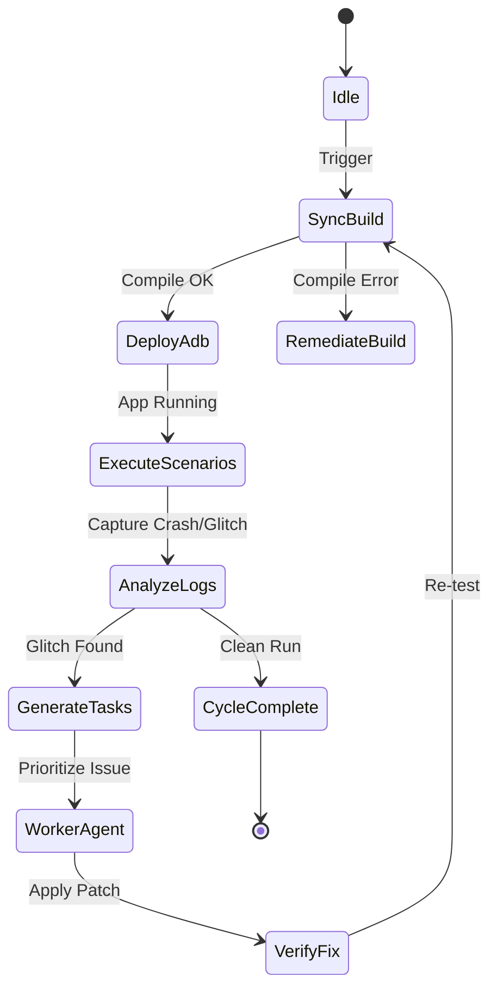

# Chorus Music: Autonomous Loop Lifecycle & Worker Pipelines

## State Machine

## Scenario Coverage Matrix
1. **App Launch & Theme Switch**:
   - Launch in Material UI -> verify Monet theme, bottom nav items.
   - Switch to Fluid UI -> verify continuous squircle tabs, liquid glass backdrop, bounce indication.
2. **Artist Full-Bleed Hero**:
   - Open artist page -> pull down for parallax zoom, verify TopFadeBlur scrim, test Play/Shuffle/Follow buttons.
3. **Lyrics Synchronization**:
   - Open full player -> switch to Lyrics view -> verify syllable glow, word bounce float, translation line display.
4. **AI DJ Set Builder**:
   - Queue sequence generation -> test Camelot wheel key adjacency and BPM pacing.

## Exit Criteria
- Zero runtime crashes over 100 navigation cycles.
- Zero unresolved syntax/lint errors in `:app:compileDebugKotlin`.
- All dual theme assets correctly loaded across both UI engines.
